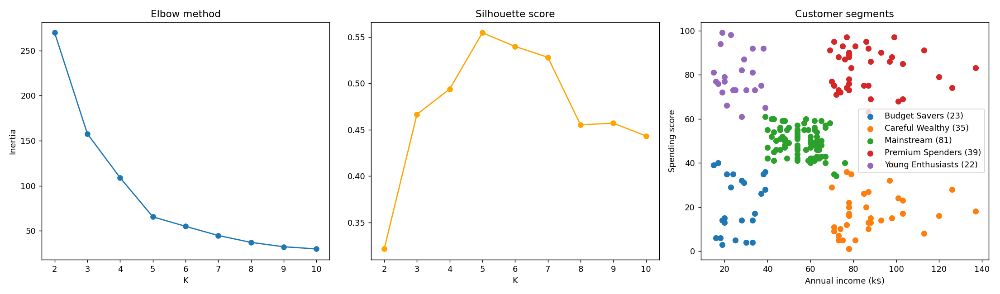

# Customer Segmentation Project

Segmenting mall customers by income and spending behavior with K-Means clustering (Python, scikit-learn), then profiling each segment by age and gender to suggest targeted marketing actions.



**Interactive dashboard:** [Open the live dashboard](https://akilarasanp.github.io/Customer-segmentation/dashboard/)

## Objective

Group customers with similar behavior so that each group can get its own marketing approach instead of one offer for everyone.

## Dataset

`Mall_Customers.csv` has 200 customers and 5 columns:

| Column | Description |
|---|---|
| CustomerID | Unique customer ID |
| Genre | Male / Female |
| Age | Age in years (18 to 70) |
| Annual Income (k$) | Annual income in thousand dollars (15 to 137) |
| Spending Score (1-100) | Score assigned by the mall based on spending behavior |

Data quality check: no missing values and no duplicate rows.

## Method

1. **Features:** Annual Income and Spending Score, standardized with `StandardScaler` so both carry equal weight.
2. **Choosing K:** Ran K-Means for K = 2 to 10 and compared the elbow curve (inertia) with the silhouette score. The elbow flattens at K = 5, and the silhouette score peaks there at **0.555**.
3. **Clustering:** Final K-Means model with K = 5 (`n_init=10`, `random_state=42`).
4. **Profiling:** Age and gender were not used for clustering. They were used afterwards to describe each segment.
5. **Naming:** Segment names were assigned from each cluster's average income and spending level.

## Results

| Segment | Customers | Share | Avg age | Avg income (k$) | Avg spending score | Female % |
|---|---|---|---|---|---|---|
| Mainstream | 81 | 40.5% | 42.7 | 55.3 | 49.5 | 59.3 |
| Premium Spenders | 39 | 19.5% | 32.7 | 86.5 | 82.1 | 53.8 |
| Careful Wealthy | 35 | 17.5% | 41.1 | 88.2 | 17.1 | 45.7 |
| Budget Savers | 23 | 11.5% | 45.2 | 26.3 | 20.9 | 60.9 |
| Young Enthusiasts | 22 | 11.0% | 25.3 | 25.7 | 79.4 | 59.1 |

## Key insights and recommendations

- **Premium Spenders:** High income and high spending, with a younger average age. Best fit for a VIP loyalty program and early access to new arrivals.
- **Careful Wealthy:** High income but very low spending, which makes them the biggest growth opportunity. Personalized recommendations and premium offers could convert them into spenders.
- **Young Enthusiasts:** Low income but high spending, average age about 25. Trend-led products, EMI options and student discounts are likely to work well.
- **Mainstream:** The largest group at 40% of customers, with moderate income and spending. Seasonal sales and combo offers help retain them.
- **Budget Savers:** Low income and low spending. Keep marketing cost low and focus on value packs and discounts.
- **Gender:** Female share is between 46% and 61% in every segment, so gender separates segments much less than age and income do.

## Files

| File | Description |
|---|---|
| `customer_segmentation.py` | Full analysis code |
| `Mall_Customers.csv` | Original dataset |
| `Mall_Customers_Segmented.csv` | Dataset with a `Cluster` and `Segment` label for every customer |
| `segmentation_charts.png` | Elbow plot, silhouette plot and segment scatter plot |
| `dashboard/index.html` | Interactive dashboard with segment filters, charts and a customer table |

## How to run

```bash
pip install pandas scikit-learn matplotlib
python customer_segmentation.py
```

Keep `Mall_Customers.csv` in the same folder as the script. It prints the segment profile table and regenerates the segmented CSV and the chart image.

## Tools

Python, pandas, scikit-learn, matplotlib

## Limitations and next steps

- The Spending Score is a single score given in the dataset, not raw purchase transactions, so purchase patterns such as product preferences could not be analyzed.
- Only 200 customers, so segment sizes are small.
- Next steps: try adding Age as a clustering feature, and compare with hierarchical clustering.
